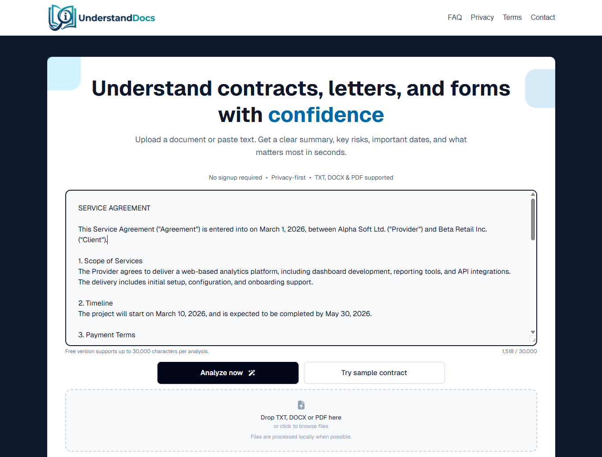
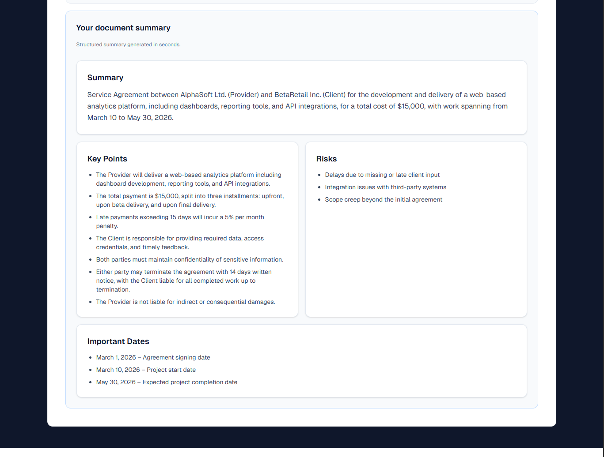

# UnderstandDocs

**Turn contracts, letters and forms into plain-language summaries in seconds.**

🌐 **Live:** [understanddocs.com](https://understanddocs.com) · no signup required




> The source code is private. This repository is a public overview of the product and its architecture.
> Source access is available on request for interview purposes.

---

## What it does

Paste text or upload a document and get a clear breakdown of key points, risks, obligations and important dates.

- **AI document analysis:** plain-language summary, red flags, deadlines and obligations in a structured, fast-to-read format
- **File support:** `.txt`, `.pdf`, `.docx`, plus scanned PDFs and images via OCR
- **Privacy first:** emails, phone numbers, IBANs, card numbers and ID-like patterns are masked **in the browser, before anything is sent**. Find & Replace for manual redaction and a "Restore original" undo path.
- **Document Guides:** a growing library of plain-language guides on contracts and common clauses (non-compete, indemnity, force majeure, automatic renewal and more)
- **Plans:** anonymous free tier with daily limits, one-time analysis, and an optional Pro workspace with saved history

## Tech stack

| Layer | Technology |
|---|---|
| Frontend | Next.js 16, React 19, TypeScript |
| Styling | Tailwind CSS v4 |
| AI | Anthropic Claude |
| Storage | Upstash Redis |
| Documents | pdfjs-dist, mammoth, OCR |
| Payments & auth | Stripe Checkout + webhooks, magic-link sign-in (Resend) |
| Testing | Vitest + Testing Library |
| Hosting & CI | Vercel, GitHub Actions |

## Architecture (high level)

An npm workspaces monorepo:

```
apps/
  main/                  main product app
  edu/                   educational app
packages/
  core/                  shared config, types, constants
  shared-ui/             shared UI components
  ai/                    shared AI helpers
  document-processing/   shared document processing pipeline
  shared-utils/          shared utilities
```

Design principles: config-driven SEO pages, shared page renderers, registry-driven content and sitemap generation, automatic metadata and JSON-LD, and client-side PII masking before any API call.

## Quality

- 1,600+ automated tests in 100+ test files
- CI on every push and pull request, production builds validated automatically
- GitFlow branching, versioned releases

## About

Built and maintained by **Ivo Nenchev**, front-end developer from Varna, Bulgaria.
Developed with AI-assisted workflows (Claude Code).

[LinkedIn](https://www.linkedin.com/in/ivonenchev)
